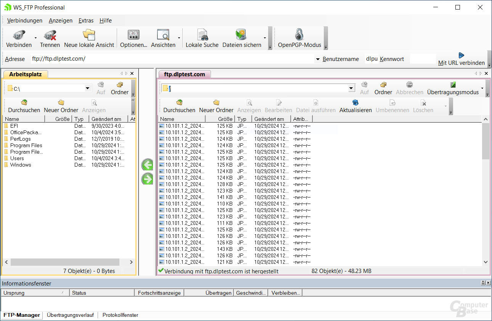
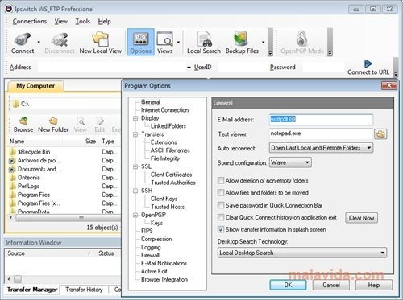

# WS_FTP for Managed Client and Server Transfers

A scheduled delivery has two owners: the person defining the transfer and the administrator controlling the destination.
Progress WS_FTP provides separate client and server products for those responsibilities.

## Put each responsibility on the correct side

WSFTP Professional is the desktop client; WSFTP Server accepts connections and manages access.
They can participate in the same workflow, but a client connection profile and a server user account configure different parts of it.

| Responsibility | Professional Client | Server |
| --- | --- | --- |
| Start a transfer | Select local and remote paths | Accept an enabled connection |
| Choose credentials | Use the configured connection identity | Authenticate the incoming identity |
| Set access boundaries | Work within the account's available paths | Assign user and group permissions |
| Repeat a delivery | Schedule or script the transfer | Provide the destination and access rules |
| Review activity | Inspect the client-side result | Inspect server-side transfer activity |

The [Professional overview](https://www.progress.com/ftp-client) describes scheduling, synchronization, and post-transfer actions.
The [Server overview](https://www.progress.com/ftp-server) describes permissions, administration, and supported transfer protocols.

[](https://wsftp-server.github.io/WSFTP-Professional/)

## Establish the connection identity

Record the agreed protocol, host, port, account, and remote starting directory.
SFTP uses SSH; FTPS secures FTP with TLS, so select the protocol the endpoint actually provides.
Confirm the expected server identity before using a saved profile for routine transfers.

Authentication also depends on the interface being used.
A browser session, an unattended client job, and a server administration session may have different login requirements.
Check the configured WS_FTP authentication method for the specific workflow.

Cyberduck's OAuth components illustrate how browser-based authorization is separated into several operations:

- [OAuth2AuthorizationService.java](oauth/src/main/java/ch/cyberduck/core/oauth/OAuth2AuthorizationService.java) validates saved OAuth tokens.
- [BrowserOAuth2AuthorizationCodeProvider.java](oauth/src/main/java/ch/cyberduck/core/oauth/BrowserOAuth2AuthorizationCodeProvider.java) starts browser-based authorization.
- [LoopbackOAuth2AuthorizationCodeProvider.java](oauth/src/main/java/ch/cyberduck/core/oauth/LoopbackOAuth2AuthorizationCodeProvider.java) handles an authorization callback through a local listener.
- [OAuth2RequestInterceptor.java](oauth/src/main/java/ch/cyberduck/core/oauth/OAuth2RequestInterceptor.java) applies OAuth authorization to HTTP requests.
- [OAuth2ErrorResponseInterceptor.java](oauth/src/main/java/ch/cyberduck/core/oauth/OAuth2ErrorResponseInterceptor.java) handles retry decisions after OAuth-related responses.

Keep that authorization model distinct from an SFTP account or an FTPS client certificate.
The useful comparison is the separation of identity acquisition, request authentication, and error handling.



## Deliver one file before scheduling a collection

Create and test a saved Professional connection profile against the intended endpoint.
Confirm that the remote folder exists and that the account can create the required file.

### A single documented command

The [WS_FTP Pro 12.9 Tools Guide](https://docs.progress.com/bundle/wsftp-pro-tools-guide-12_9/page/Transfer-Destination.html) documents source and destination arguments.
For a saved site named Accounts inside the Partners site folder, an illustrative upload is:

```powershell
wsftppro -binary -s "local:C:\Transfer\invoice.csv" -d "Partners!Accounts:/incoming/invoice.csv"
```

Replace the illustrative source path, saved site, and remote path with the configured values.
The saved profile determines the connection settings; the example does not put credentials in the command.
Use binary mode when the delivered bytes should remain unchanged.

### Destination access is a server decision

For an inbound WS_FTP workflow, separate permission to list a folder from permission to upload, rename, or delete its contents.
Test the required operations with the transfer account rather than an administrator account.

Cyberduck's Azure modules expose related concepts through a different storage API.
[AzureAclPermissionFeature.java](azure/src/main/java/ch/cyberduck/core/azure/AzureAclPermissionFeature.java) describes container access roles.
[AzureAttributesFinderFeature.java](azure/src/main/java/ch/cyberduck/core/azure/AzureAttributesFinderFeature.java) delegates attribute lookup by storage type.
[AzureMetadataFeature.java](azure/src/main/java/ch/cyberduck/core/azure/AzureMetadataFeature.java) handles metadata, while [AzureExceptionMappingService.java](azure/src/main/java/ch/cyberduck/core/azure/AzureExceptionMappingService.java) maps failures into client exceptions.

A successful login alone does not prove that the destination permissions suit the delivery.
Check the remote path as seen by that account, including any virtual folder mapping.



## Turn a manual delivery into a repeatable job

The WS_FTP Pro workflow can be repeated with a command file and the client's scheduling tools.
First settle the naming convention, replacement behavior, and expected delivery window.

The documented command-file mechanism uses one argument line per operation.
For example, a locally prepared transfers.txt could contain:

```text
-binary -s "local:C:\Transfer\invoice.csv" -d "Partners!Accounts:/incoming/invoice.csv"
-binary -s "local:C:\Transfer\invoice-lines.csv" -d "Partners!Accounts:/incoming/invoice-lines.csv"
```

Invoke that command file with `wsftppro -m transfers.txt`.
The executable name is omitted inside the file, as specified in the [multiple-command documentation](https://docs.ipswitch.com/WS_FTP125/Help/Tools/English/18014.htm).
The examples follow the published Tools Guide syntax; confirm behavior against the installed Professional version.

Define what happens when an earlier scheduled run is still active.
Keep source generation separate from delivery so a file is complete before the transfer begins.
Choose post-transfer actions only after deciding how a failed or repeated delivery should be recovered.

Cyberduck's Dropbox implementation separates directory discovery from content transfer.
[DropboxDirectoryFeature.java](dropbox/src/main/java/ch/cyberduck/core/dropbox/DropboxDirectoryFeature.java) creates directories, and [DropboxListService.java](dropbox/src/main/java/ch/cyberduck/core/dropbox/DropboxListService.java) retrieves directory listings.
[DropboxWriteFeature.java](dropbox/src/main/java/ch/cyberduck/core/dropbox/DropboxWriteFeature.java) and [DropboxReadFeature.java](dropbox/src/main/java/ch/cyberduck/core/dropbox/DropboxReadFeature.java) implement content writing and reading.

That separation is useful when diagnosing a job that can browse a destination but cannot deliver its payload.
Review the failing operation before changing credentials or permissions.

## Decide what counts as a completed delivery

A transfer finishing and a recipient processing the file are separate events.
For Progress WS_FTP operations, agree whether completion means arrival, successful validation, or acceptance by a downstream application.

### Recover without creating a second business event

- Identify the expected remote filename before retrying.
- Determine whether an existing file is complete, partial, or already processed.
- Confirm whether replacement is permitted for that delivery.
- Keep the original source available until the agreed acceptance point.
- Reconcile the client result with the server activity record.

Copying, renaming, and restoring content can have different consequences.
Cyberduck's [DropboxCopyFeature.java](dropbox/src/main/java/ch/cyberduck/core/dropbox/DropboxCopyFeature.java) and [DropboxMoveFeature.java](dropbox/src/main/java/ch/cyberduck/core/dropbox/DropboxMoveFeature.java) use distinct provider operations.
[DropboxVersioningFeature.java](dropbox/src/main/java/ch/cyberduck/core/dropbox/DropboxVersioningFeature.java) exposes revision-related operations.
[DropboxSingleTransferWorkerTest.java](dropbox/src/test/java/ch/cyberduck/core/worker/DropboxSingleTransferWorkerTest.java) exercises a transfer worker with overwrite handling.

### Verify resume support for the actual protocol

An interrupted upload does not establish how the next attempt should continue.
Cyberduck's [TusCapabilities.java](tus/src/main/java/ch/cyberduck/core/tus/TusCapabilities.java) defines resumable-HTTP capability headers.
[TusUploadHelper.java](tus/src/main/java/ch/cyberduck/core/tus/TusUploadHelper.java) retrieves an upload offset, while [TusWriteFeature.java](tus/src/main/java/ch/cyberduck/core/tus/TusWriteFeature.java) writes through HTTP PATCH.
These files show why resumption depends on protocol-specific state rather than only the existence of a remote filename.

For an Ipswitch WS_FTP deployment, use documentation that matches the installed client and server versions.
Confirm edition-specific modules before planning browser transfers or additional authentication features.
The [Professional documentation index](https://docs.ipswitch.com/en/ws_ftp-professional.html) and [Server documentation index](https://docs.ipswitch.com/en/ws_ftp-server.html) point to the relevant documentation generations.

## Related Search Terms

WSFTP Professional, WSFTP Server, ws_ftp pro, progress ws_ftp, ipswitch ws_ftp, ftp, ftp-client, ftp-server, ftps, sftp, sftp-server, ssh, file-transfer, automation, windows
